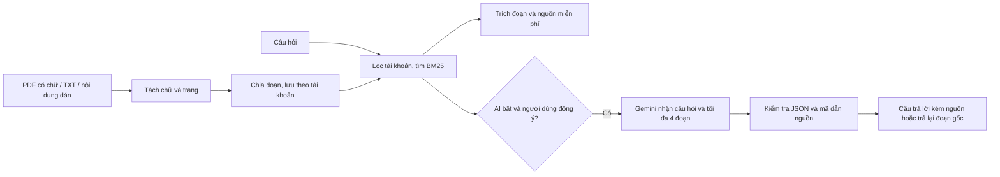

# Hỏi tài liệu và RAG trong LifeHub

Bản local ngày 24/10/2026. Chưa push GitHub hoặc triển khai Render. AI thật đang tắt vì chủ dự án chưa xác nhận Billing; không gọi Google trong đợt kiểm thử này.

## Dùng ngay, không cần khóa AI

1. Mở http://127.0.0.1:5173, đăng nhập tài khoản local.
2. Mở trợ lý góc dưới → **Hỏi tài liệu**. Thử “LifeHub tính GPA như thế nào?”.
3. Chọn **Quản lý tài liệu** → **Thêm tài liệu**. Nhập tên và chọn PDF có chữ, TXT/MD UTF-8, hoặc dán nội dung.
4. Sau khi lưu, đọc lại nội dung được trích xuất. Mở trợ lý, hỏi một câu cụ thể có trong tài liệu.
5. Bấm nguồn [S1] để xem đoạn trích và mở bản chữ của tài liệu.
6. Có thể xóa tài liệu sau xác nhận. Các trích đoạn đã hiển thị trong cuộc trò chuyện vẫn tồn tại đến khi bắt đầu cuộc trò chuyện mới.

Hướng dẫn LifeHub đi kèm do dự án tự viết, không phải quy định của trường. Muốn hỏi quy chế trường phải thêm đúng tài liệu trường. Không dùng các quy định giả trong kiểm thử làm căn cứ thực tế.

## Hai cách trả kết quả

- **Tìm và đọc tài liệu** (mặc định): trả trích đoạn nguyên văn, tên tài liệu, trang/phần. Không dùng LLM, không gọi API AI, không phải câu trả lời AI sinh ra.
- **Nhờ AI giải thích kèm nguồn**: phần RAG đã tích hợp trong mã. Chỉ bật được khi backend được cấu hình AI và người dùng đồng ý gửi câu hỏi cùng đoạn liên quan. Mô hình diễn giải, máy chủ kiểm tra mã nguồn rồi giao diện hiển thị câu trả lời và nguồn.

Đây là RAG dùng truy xuất từ khóa BM25, không phải tìm kiếm vector/embedding. Một hệ thống RAG không bắt buộc dùng vector; tuy nhiên tìm từ khóa có thể bỏ sót câu diễn đạt bằng từ đồng nghĩa. Không đủ kết quả thì báo thiếu căn cứ. Tìm được đoạn cùng chủ đề chưa bảo đảm có đáp án.

## Luồng xử lý

- Chia đoạn khoảng 1.200 ký tự, chồng lấn khoảng 160 ký tự, giữ số trang.
- Chuẩn hóa chữ hoa/thường, dấu tiếng Việt và từ dừng. BM25 xếp hạng; yêu cầu ít nhất 2 từ khớp (1 khi câu chỉ còn 1 từ khóa), độ phủ ít nhất 65%.
- Tối đa 4 đoạn, tối đa 2 đoạn mỗi tài liệu; không gửi toàn bộ kho đến AI.
- AI nhận câu hỏi độc lập; không gửi lịch sử trò chuyện, GPA hoặc thu chi trong chế độ tài liệu.
- JSON gồm duThongTin và các ý trả lời có mã nguồn. Mã không tồn tại, câu trả lời lỗi cấu trúc hoặc bị cắt → không hiển thị diễn giải; trả đoạn gốc.
- Kiểm tra mã nguồn chỉ chứng minh nguồn thuộc kết quả truy xuất, **không chứng minh mọi phát biểu AI đúng với nguồn**. Người dùng vẫn cần đối chiếu.

## Giới hạn và dữ liệu

- Mỗi tài khoản: tối đa 20 tài liệu, tổng 600.000 ký tự.
- Mỗi tệp: tối đa 4 MB, 200.000 ký tự, PDF tối đa 100 trang.
- PDF chụp/scan chưa hỗ trợ; không sử dụng OCR thời khóa biểu để đọc mọi PDF. Có thể dán chữ thay thế.
- PDF được đọc trong tiến trình riêng có hạn thời gian 15 giây và bộ nhớ V8 128 MB; tối đa 2 tiến trình đồng thời. Lỗi trình đọc không làm sập API.
- Chỉ lưu bản chữ đã chia đoạn và metadata; không lưu nguyên tệp nhị phân. Trang xem tài liệu hiển thị bản chữ, không phải bản PDF gốc.
- Tài liệu thuộc tài khoản JWT. Không nhận ID chủ tài khoản từ người gọi; tài khoản khác không đọc, xóa hoặc truy xuất được.
- Nội dung hiển thị dưới dạng chữ, không thực thi HTML hoặc lệnh trong tài liệu. Chỉ dẫn cho AI yêu cầu coi nội dung là dữ liệu; không cam kết loại bỏ hoàn toàn prompt injection.
- Lịch sử chat chỉ ở bộ nhớ giao diện, không lưu CSDL/localStorage. API đặt no-store.
- Nội dung có thể được truyền đến Google chỉ khi người dùng chọn AI và đồng ý; không bật AI đồng nghĩa không gửi tới Google.

## Khi muốn thử AI thật miễn phí

Giữ `CHATBOT_AI_ENABLED=false` hiện tại. Tên model không xác định việc có tính phí: cần kiểm tra dự án gắn khóa tại Google AI Studio có trạng thái Free và chưa bật Billing. Không gửi khóa vào chat, không đặt khóa trong front hoặc biến VITE_*.

Sau khi tự xác nhận điều kiện miễn phí và hạn mức, cấu hình backend theo [CHATBOT_AI.md](CHATBOT_AI.md), khởi động lại rồi chọn AI trong Hỏi tài liệu. Không tự đổi sang dịch vụ/model trả phí khi hết hạn mức. Nếu chưa xác nhận thì tiếp tục dùng tìm và đọc tài liệu.

Chưa đánh giá độ chính xác, tốc độ hay hạn mức của model thật. Chưa đủ bằng chứng để ghi “RAG đã nghiệm thu AI thực tế” trong báo cáo đồ án.

## Triển khai sau này

Cần cập nhật **cả backend và frontend**. Backend chạy `npm ci`, `npx prisma generate`, `npx prisma migrate deploy` trước khi chạy ứng dụng; migration mới là `20261024000000_rag_documents`. Script Render hiện tại đã có bước migration, nhưng phải xem log triển khai xác nhận thành công. Dữ liệu online chưa được thay đổi trong đợt này.

CSDL local từng có cấu trúc nhóm học nhưng thiếu bản ghi migration. Đã so sánh với CSDL thử tạo từ migration: 39 cột, 18 index và 41 ràng buộc khớp; sau đó đồng bộ lịch sử rồi thêm bảng mới. Không áp dụng cách đánh dấu này tùy tiện trên online; phải kiểm tra cấu trúc cụ thể trước.

## Minh chứng và tài liệu kỹ thuật

- [Báo cáo kiểm thử RAG](../reports/RAG_2026_10_24.md).
- [PDF parser](https://github.com/mehmet-kozan/pdf-parse): thư viện đọc chữ PDF.
- [Structured output Gemini](https://ai.google.dev/gemini-api/docs/structured-output): cấu trúc đầu ra; kiểm tra cấu trúc không bảo đảm đúng ngữ nghĩa.
- [Google Cloud giải thích RAG](https://cloud.google.com/use-cases/retrieval-augmented-generation): cơ sở truy xuất kết hợp sinh câu trả lời.

## Update 28/10/2026
Vietnamese phrase aliases now normalize TKB, deadline, GPA and receipt terms before BM25 ranking. Original excerpts remain unchanged. Numeric facts and links must occur in cited excerpts; unsupported or malformed output falls back to excerpts. This conservative check may reject a valid numerical reformatting. It does not prove every natural-language claim is correct. Real model quality and scanned PDF OCR remain unverified/unsupported.
