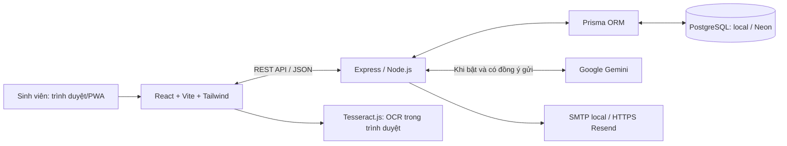
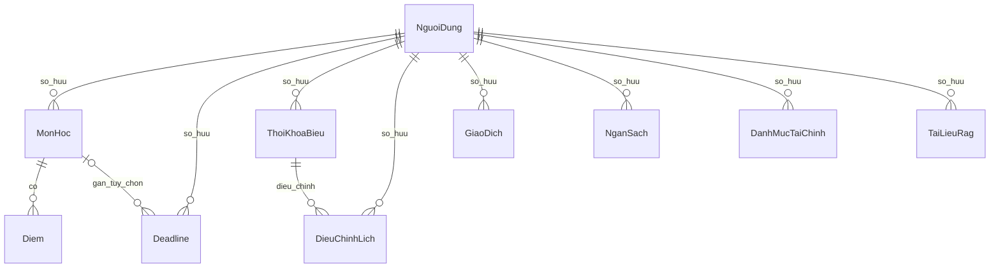
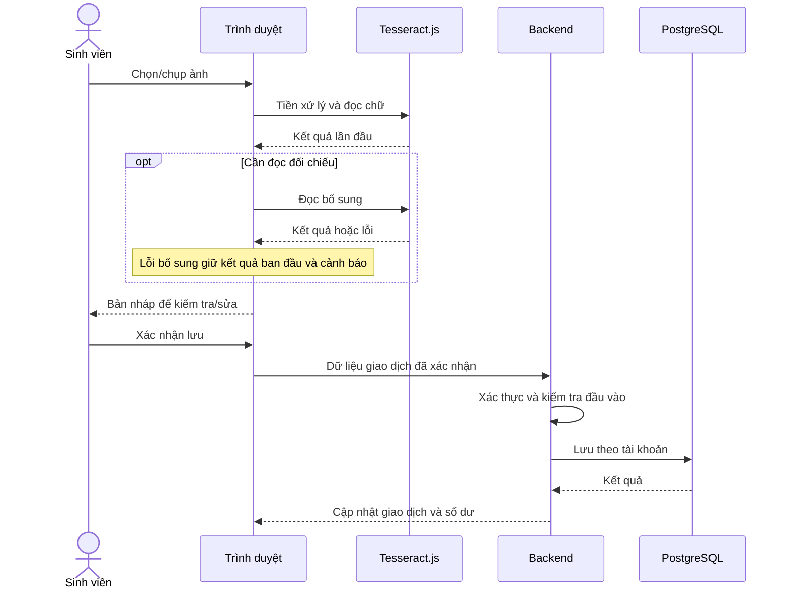

# Thiết kế hệ thống LifeHub
Đối chiếu mã nguồn ngày 29/10/2026. Đây là mô tả triển khai hiện tại để bổ sung hồ sơ đồ án; không giả định mọi dịch vụ online đã được nghiệm thu.

## Phạm vi chính
Sinh viên quản lý học tập/điểm, học kỳ, lịch học, deadline, thu chi/ngân sách, hồ sơ và tài liệu cho trợ lý.
Mã nguồn vẫn chứa module nhóm học và các bảng liên quan; mục này không nằm trong menu chính hiện tại. Cần phân biệt chức năng cũ còn trong mã với phạm vi demo chính.

## Kiến trúc

Backend tổ chức theo module: route → xác thực/kiểm tra đầu vào → controller/service → Prisma.
Quyền truy cập dữ liệu lấy từ tài khoản xác thực, không tin id người dùng trong nội dung gửi lên.
Mật khẩu được băm bằng bcrypt; JWT chứa mốc đổi mật khẩu để từ chối phiên cũ.
PWA dùng manifest/service worker; đọc/lưu dữ liệu vẫn cần máy chủ. Không tuyên bố hỗ trợ chỉnh sửa offline.

## Use Case chính
| Mã | Tác nhân | Chức năng | Quy tắc quan trọng |
|---|---|---|---|
| UC01 | Sinh viên | Đăng ký/đăng nhập/đăng xuất/khôi phục mật khẩu | Dữ liệu riêng chỉ được đọc sau xác thực |
| UC02 | Sinh viên | Lưu/đổi/xóa học kỳ | Kỳ trống vẫn được giữ; xóa cần xác nhận đúng phạm vi |
| UC03 | Sinh viên | Quản lý môn/điểm/GPA | Tổng trọng số không quá 100%; GPA thang 10 |
| UC04 | Sinh viên | Quản lý TKB, nhập ảnh, điều chỉnh buổi | Kiểm tra trùng giờ; OCR chỉ tạo bản nháp |
| UC05 | Sinh viên | Quản lý deadline | Hoàn thành/mở lại thống nhất; ngày không có giờ tính đến cuối ngày |
| UC06 | Sinh viên | Thu chi/danh mục/ngân sách/xuất báo cáo | Tiền đồng nguyên; danh mục ẩn không xóa lịch sử |
| UC07 | Sinh viên | Tìm tài liệu/hỏi AI | Chỉ dùng tài liệu được phép; có nguồn, biết từ chối khi thiếu căn cứ |
| UC08 | Người nhận link | Xem TKB chia sẻ | Phạm vi được cố định khi cấp link; tắt chia sẻ chặn link |

## ERD phần chính — quan hệ khóa ngoại thật

- NguoiDung lưu hocKyHienTai và mảng hocKyDaLuu; hiện không có bảng HocKy riêng.
- Danh mục giao dịch/ngân sách được lưu bằng mã chuỗi kết hợp tài khoản. Không vẽ khóa ngoại trực tiếp giữa GiaoDich/NganSach và DanhMucTaiChinh vì schema chưa có khóa đó.
- NganSach duy nhất theo tài khoản + danh mục + tháng + năm.
- DieuChinhLich duy nhất theo buổi gốc + ngày gốc.
- TaiLieuRag lưu đoạn chữ và thông tin nguồn, duy nhất theo tài khoản + băm nội dung. PDF scan chưa được hỗ trợ đọc chữ.
- GiaoDich chỉ lưu băm ảnh để hỗ trợ nhận biết hóa đơn; ảnh gốc được xử lý ở trình duyệt.
- Thông báo chính được tổng hợp từ dữ liệu nghiệp vụ; schema hiện không có bảng ThongBao.

Các bảng nhóm còn trong schema: NhomHocTap, ThanhVienNhom, DeadlineNhom, TienDoDeadlineNhom.
Nguồn chuẩn để vẽ đầy đủ thuộc tính và quan hệ: back/prisma/schema.prisma.

## Luồng OCR hóa đơn

## AI/RAG và giới hạn
RAG dùng chia đoạn + BM25 với chuẩn hóa tiếng Việt. Tìm kiếm không AI trả trích đoạn; khi bật AI và người dùng đồng ý, backend gửi đoạn liên quan đến Gemini.
Kiểm tra mã dẫn nguồn, số liệu và đường dẫn giúp loại kết quả không hợp lệ, nhưng không chứng minh mọi diễn giải tự nhiên đều đúng.
Chưa đo AI thật khi chưa xác nhận cấu hình miễn phí. Không gọi cơ chế tra cứu từ khóa là vector database hoặc mô hình tự huấn luyện.

## Đối chiếu yêu cầu và kiểm thử
UC01–UC06 có kiểm thử API/CSDL và các luồng trình duyệt trong front/e2e/core.spec.js.
UC07 có bộ test RAG/API; chất lượng AI thật cần nghiệm thu riêng.
UC08 có test phạm vi và thu hồi link chia sẻ ở backend.
Quy trình nghiệm thu thủ công: docs/guides/USER_ACCEPTANCE_2026_10_29.md.
Nguồn kết quả tự động phải ghi rõ ngày, môi trường và mô phỏng; không gán kết quả local cho bản online.
